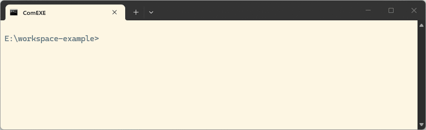
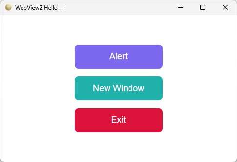

# 📋 ComEXE

**`lua55ce` is a statically linked drop-in replacement for the [Lua standalone program](https://www.lua.org/manual/5.5/manual.html#7). Its extended command `--make` packs a Lua project into a standalone executable for Windows x64 or Linux x64, without any C/C++ compiler.**

```sh
> lua55ce src\hello.lua                                # run a script
> lua55ce -x --make src\hello.lua                      # standalone executable, current OS, ~2.0 MiB
> lua55ce -x --make src\hello.lua -t x86_64-linux-musl # same script, Linux x64 executable
```

The extended commands (`--make`, `--compile`) are prefixed with `-x`. Without it, the behavior is the same as the standalone Lua interpreter.

[](https://github.com/pascalcombier/comexe/releases/latest)


[](./LICENSE)



# 🚀 Quick start

Download and extract the [latest binary release](https://github.com/pascalcombier/comexe/releases/latest), rename `lua55ce-x86_64.exe` to `lua55ce.exe` for convenience:

```sh
> lua55ce -v
Lua 5.5.1  Copyright (C) 1994-2025 Lua.org, PUC-Rio, ComEXE 0.0.12 2026-10-11T16:35:28
> mkdir src
> echo print("Hello World!") > src\hello.lua
> lua55ce src\hello.lua
Hello World!
> lua55ce -x --make src\hello.lua
> hello.exe
Hello World!
```

The same commands work on Linux: use `src/hello.lua`, the output file is `hello` instead of `hello.exe`, and it is run with `./hello`.

Option `--verbose` shows more information:

```
> lua55ce -x --make src\hello.lua --verbose
Building target 'x86_64-windows' -> hello.exe
NOTE compressing directory 'src'
hello.exe created (2.0 MiB)
```

The key point is that the whole `src` directory is packed and included in the standalone executable, not only `hello.lua`. See [Standalone executables](./doc/comexe-reference-standalone-executables.md) for details.

# 🌐 Cross-compiling

Windows and Linux hosts can build for both systems:

```sh
> lua55ce -x --list-targets
x86_64-windows
x86_64-windows-dbg
x86_64-windows-gui
x86_64-linux-musl
x86_64-linux-musl-dbg
x86_64-linux-gnu
x86_64-linux-gnu-dbg
```

The default, with no suffix, is the console build. `-dbg` is the debug build, `-gui` is the Windows GUI build.

| Build                                   | Size     |
|-----------------------------------------|----------|
| Windows x64, full runtime               | 1.99 MiB |
| Windows x64, `--nostdlib`               | 1.41 MiB |
| Linux x64, `x86_64-linux-musl` (static) | 2.82 MiB |
| Linux x64, `x86_64-linux-gnu` (glibc)   | 2.64 MiB |

The option `--nostdlib` strips all the Lua modules from the executable.

# 📦 Features

**lua55ce program**

- Generate standalone executables: nothing to install on the target machine
- Generate FFI bindings from C headers with the preprocessor
- Compile Fennel code to Lua

**Runtime libraries**

- Native threads: one per Lua state
- libffi: call C libraries from Lua
- libuv (luv), LuaSocket, mbedtls, LPEG, dkjson, minizip
- SQLite (needs `sqlite3.dll` or `libsqlite3.so.0`)

**Windows-specific**

- WebView2 UI (needs `WebView2Loader.dll` and the WebView2 runtime)
- Win32 COM automation (Excel, Word and Outlook)
- Win32 API

Windows GUI from Lua:



# ℹ️ Status

- Tracks PUC Lua 5.5, not LuaJIT
- Pre-1.0: command options and APIs may change
- Windows x64 and Linux x64 only. No macOS, iOS or Android

# 📘 Documentation

**Guides**

- [Fetching JSON data over HTTP](./doc/page-github-http-client.md)
- [Using the FFI to wrap a C library](./doc/page-ffi-sqlite.md)
- [Using Fennel with ComEXE](./doc/page-fennel.md)
- [Building a GUI with WebView2](./doc/page-webview2.md)
- [Using Easycom with Excel](./doc/page-win32-com-excel.md)
- [Using the FFI to build a Win32 GUI](./doc/page-ffi-win32-gui.md)

**Notes**

- [Building ComEXE from source](./doc/page-build-from-source.md)
- [Unicode on Windows](./doc/comexe-page-utf8-on-windows.md)
- [Differences with Lua PUC](./doc/page-differences-lua-puc.md)

**Reference**

- [Standalone executables](./doc/comexe-reference-standalone-executables.md)
- [Threads](./doc/comexe-reference-threads.md)
- [FFI](./doc/comexe-reference-ffi.md)
- [Preprocessor](./doc/comexe-reference-preprocessor.md)
- [SQLite](./doc/comexe-reference-sqlite3.md)
- [WebView2](./doc/comexe-reference-webview2.md)
- [Win32 API](./doc/comexe-reference-win32.md)

# 🎯 Alternatives

| Topic               | ComEXE                               | luastatic                        | clx                                  | LuaRT                                  |
|---------------------|--------------------------------------|----------------------------------|--------------------------------------|----------------------------------------|
| Lua                 | 5.5                                  | 5.1-5.4, LuaJIT                  | 5.5                                  | 5.5                                    |
| Platforms           | Windows x64, Linux x64 (glibc, musl) | Any                              | Linux x64, macOS ARM64, Windows x64  | Windows 8.1+ (x86, x64)                |
| Exe generation      | No compiler needed                   | Needs C compiler + `liblua.a`    | Needs C++ compiler                   | No compiler needed                     |
| Cross-compile       | Yes (Windows and Linux hosts)        | No                               | No                                   | No                                     |
| Native threads      | Yes, one per Lua state               | No                               | No                                   | Tasks only (coroutines)                |
| Sockets             | TCP, UDP, HTTP(S), TLS (mbedtls)     | Not built in (link via LuaRocks) | Not built in (link with `--modules`) | TCP only, HTTP(S), FTP, TLS (SChannel) |
| FFI                 | libffi, callbacks                    | Via LuaJIT                       | No                                   | Limited, no callbacks                  |
| Windows integration | Win32, COM, Registry, WebView2       | None                             | None                                 | 25 modules: GUI, audio, serial, Wi-Fi  |
| Deployment          | One exe, 1.4-2.8 MiB                 | One exe, ~1 MiB static           | One exe                              | One exe + VC++ runtime                 |
| Runtime             | Lua VM (bytecode)                    | Lua VM (bytecode)                | Native code (AOT)                    | Lua VM (bytecode)                      |

This table refers to out-of-the-box capabilities only. All four tools can use additional C libraries: ComEXE and LuaRT through FFI, luastatic and clx by linking.

Checked 2026-10 against luastatic, clx (beta) and LuaRT.

# 📄 License

[MIT](./LICENSE)
